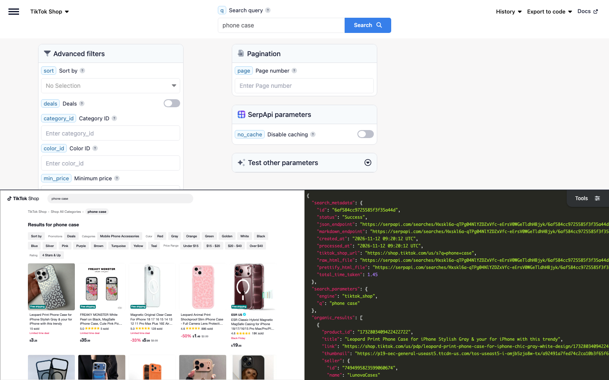

# TikTok Shop Scraper

Scrape TikTok Shop search results with SerpApi's TikTok Shop API. Search products on TikTok Shop in the US by keyword, and get each product's ID, title, link, thumbnail, brand, seller, price, discount, rating, reviews, number sold, deal badges, and free shipping, plus the category, color, price, and rating filters TikTok Shop shows for the search.

## How to scrape TikTok Shop search results

Search TikTok Shop with a simple GET request:

```text
https://serpapi.com/search?engine=tiktok_shop&q=phone+case&api_key=SERPAPI_API_KEY
```

- `q` is the search query: anything you'd use in a regular TikTok Shop search, e.g., `phone case`, `coffee`, or `vitamin c serum`. The results are from TikTok Shop in the US, with prices in US dollars.
- `api_key` is your SerpApi API key. Replace `SERPAPI_API_KEY` with it.
- `sort` sorts the products by best sellers or newest instead of relevance. TikTok Shop's price sorts aren't supported; use `min_price` and `max_price` instead.
- `deals`, `rating`, `min_price`, and `max_price` only show the products with deals, the products rated 4 stars and up, or the products in a price range, in whole US dollars, e.g., `20`.
- `category_id` and `color_id` filter the products by category or color with the IDs in `filters` from a previous response, e.g., `909064` for Mobile Phone Accessories or `1001063` for Black.
- `page` gets the next pages of results. Each page has up to 30 products.

TikTok Shop returns products even for a query without matching products, e.g., watches and bracelets for `xqzvbnmplkjhgfdsa`, and applies `deals`, `min_price`, and `max_price` loosely. For a page after the last one or an unknown `category_id`, the response has no products and the error "TikTok Shop hasn't returned any results for this query."

[Register at SerpApi](https://serpapi.com?utm_source=github_tiktok_shop_scraper) to get your API key, and keep it private.

### Playground

Try the request live in the [SerpApi Playground](https://serpapi.com/playground?engine=tiktok_shop&q=phone+case&utm_source=github_tiktok_shop_scraper).

[](https://serpapi.com/playground?engine=tiktok_shop&q=phone+case&utm_source=github_tiktok_shop_scraper)

## Code examples

The code examples read your API key from the `SERPAPI_API_KEY` environment variable:

```bash
export SERPAPI_API_KEY="SERPAPI_API_KEY"
```

Each example searches TikTok Shop for phone cases and prints the title, price, and number sold of each product.

### curl integration

Send the request with curl, which prints the full JSON response:

```bash
curl --get https://serpapi.com/search \
 --data-urlencode engine="tiktok_shop" \
 --data-urlencode q="phone case" \
 --data-urlencode api_key="$SERPAPI_API_KEY"
```

### JavaScript integration

Install the [SerpApi JavaScript library](https://github.com/serpapi/serpapi-javascript) and set your project to use ES modules:

```bash
npm install serpapi
npm pkg set type=module
```

Create an `index.js` file:

```javascript
import { getJson } from "serpapi";

const results = await getJson({
  engine: "tiktok_shop",
  api_key: process.env.SERPAPI_API_KEY,
  q: "phone case",
});

for (const product of results.organic_results ?? []) {
  console.log(product.title, product.price, product.sold);
}
```

Run it with `node index.js`.

### Python integration

Install the [SerpApi Python library](https://github.com/serpapi/serpapi-python):

```bash
pip install serpapi
```

Create a `main.py` file:

```python
import os
import serpapi

client = serpapi.Client(api_key=os.getenv("SERPAPI_API_KEY"))
results = client.search({
    "engine": "tiktok_shop",
    "q": "phone case",
})

for product in results.get("organic_results", []):
    print(product["title"], product["price"], product.get("sold"))
```

Run it with `python main.py`.

### Ruby integration

Install the [SerpApi Ruby library](https://github.com/serpapi/serpapi-ruby):

```bash
gem install serpapi
```

Create a `main.rb` file:

```ruby
require "serpapi"

client = SerpApi::Client.new(engine: "tiktok_shop", api_key: ENV.fetch("SERPAPI_API_KEY"))
results = client.search(q: "phone case")

results.fetch(:organic_results, []).each do |product|
  puts "#{product[:title]} #{product[:price]} #{product[:sold]}"
end

client.close
```

Run it with `ruby main.rb`.

### PHP integration

Install the [SerpApi PHP library](https://github.com/serpapi/serpapi-php):

```bash
composer require serpapi/serpapi-php
```

Create an `index.php` file:

```php
<?php
require 'vendor/autoload.php';

use SerpApi\Client;

$client = new Client(getenv('SERPAPI_API_KEY'), 'tiktok_shop');
$results = $client->search([
  'q' => 'phone case',
]);

foreach ($results->organic_results ?? [] as $product) {
  echo $product->title . ' ' . $product->price . ' ' . ($product->sold ?? '') . PHP_EOL;
}
```

Run it with `php index.php`.

### Go integration

Create a Go module and install the [SerpApi Go library](https://github.com/serpapi/serpapi-golang):

```bash
go mod init example.com/tiktokshop
go get github.com/serpapi/serpapi-golang
```

Create a `main.go` file:

```go
package main

import (
	"fmt"
	"os"

	"github.com/serpapi/serpapi-golang"
)

func main() {
	setting := serpapi.NewSerpApiClientSetting(os.Getenv("SERPAPI_API_KEY"))
	setting.Engine = "tiktok_shop"
	client := serpapi.NewClient(setting)

	results, err := client.Search(map[string]string{
		"q": "phone case",
	})
	if err != nil {
		panic(err)
	}

	organicResults, _ := results["organic_results"].([]interface{})
	for _, item := range organicResults {
		product := item.(map[string]interface{})
		fmt.Println(product["title"], product["price"], product["sold"])
	}
}
```

Run it with `go run .`.

### Rust integration

Create a Cargo project and add the [SerpApi Rust library](https://github.com/serpapi/serpapi-rust) and Tokio:

```bash
cargo new tiktok-shop && cd tiktok-shop
cargo add serpapi tokio --features tokio/full
```

Replace `src/main.rs` with:

```rust
use serpapi::serpapi::Client;
use std::collections::HashMap;
use std::env;

#[tokio::main]
async fn main() -> Result<(), Box<dyn std::error::Error>> {
    let mut default = HashMap::new();
    default.insert("api_key".to_string(), env::var("SERPAPI_API_KEY")?);
    default.insert("engine".to_string(), "tiktok_shop".to_string());
    let client = Client::new(default)?;

    let mut parameter = HashMap::new();
    parameter.insert("q".to_string(), "phone case".to_string());

    let results = client.search(parameter).await?;
    if let Some(organic_results) = results["organic_results"].as_array() {
        for product in organic_results {
            println!(
                "{} {} {}",
                product["title"].as_str().unwrap_or_default(),
                product["price"].as_str().unwrap_or_default(),
                product["sold"].as_u64().unwrap_or_default()
            );
        }
    }
    Ok(())
}
```

Run it with `cargo run`.

### Other programming languages

Official libraries are also available for [Java](https://github.com/serpapi/serpapi-java), [.NET](https://github.com/serpapi/serpapi-dotnet), [Swift](https://github.com/serpapi/serpapi-swift), and [C++](https://github.com/serpapi/serpapi-cpp). See [SerpApi integrations](https://serpapi.com/integrations?utm_source=github_tiktok_shop_scraper) for setup guides, or use a simple GET request from any programming language.

### Errors

Failed requests return an HTTP error status and a JSON body with an `error` message. The most common are `401` for an invalid API key, `400` for a missing or invalid parameter, such as a missing `q` or an unsupported `sort` like `price_asc`, and `429` when you exceed your hourly throughput limit or run out of searches. See [API status and error codes](https://serpapi.com/api-status-and-error-codes?utm_source=github_tiktok_shop_scraper) for the full list.

A search without products, e.g., a page after the last one or an unknown `category_id`, still returns `200`, with `search_metadata.status` set to `Success`, `search_information.organic_results_state` set to `Fully empty`, and an `error` message, so check for `error` before reading `organic_results`.

## Output formats: JSON and Markdown

Choose structured JSON for applications or Markdown for LLMs and AI agents:

- JSON is the default output and is useful when you need individual result fields.
- Add `output=md` to receive Markdown instead, which is more token-efficient.

Markdown is plain text, not JSON: YAML front matter with the search metadata, followed by a table of the products with their seller, price, discount, rating, and number sold, the names of the filters, and a link to the next page. The filter options and their IDs are only in the JSON response. Read the response body as text instead of parsing it.

| Client | Markdown request |
|--------|------------------|
| curl | `--data-urlencode output="md"` |
| Python | `client.search({..., "output": "md"})` |
| PHP | `$client->md([...])` |
| Go | `client.Md(map[string]string{...})` |
| Rust | `client.md(parameter).await?` |

If your SDK doesn't have a Markdown helper yet, send a plain HTTP request with `output=md` and read the body as text. Learn more about [Markdown output](https://serpapi.com/markdown-output?utm_source=github_tiktok_shop_scraper).

## TikTok Shop API parameters

See the [TikTok Shop API documentation](https://serpapi.com/tiktok-shop-api?utm_source=github_tiktok_shop_scraper) for more details.

| Name | Description | Requirement |
|------|-------------|-------------|
| **Search query** | | |
| `q` | The search query: anything you'd use in a regular TikTok Shop search (e.g., `coffee`, `phone case`, or `vitamin c serum`). The results are from TikTok Shop in the US, with prices in US dollars. TikTok Shop always returns products, even for a query without matching products (e.g., watches and bracelets for `xqzvbnmplkjhgfdsa`). | Required |
| **Advanced filters** | | |
| `sort` | The sort order: `relevance` for Relevance (default), `best_seller` for Best sellers, or `newest` for Newest. With `best_seller`, the first few products aren't always in order, and the rest are sorted by number sold (`sold`). TikTok Shop's Price low to high and Price high to low sorts aren't supported; use `min_price` and `max_price` to filter by price instead. | Optional |
| `deals` | Set to `true` to only show products with deals, like TikTok Shop's Deals filter, or `false` (default). TikTok Shop applies it loosely and also returns some products without a discount or deal badge. | Optional |
| `category_id` | The categories of the products, like TikTok Shop's Categories filter, as a comma-separated list of category IDs (e.g., `914824` for Drinks, or `914824,915336` for Drinks and Snacks). The categories depend on the search, and their IDs are in `filters[].options[].category_id` of the response. An unknown category ID returns no products. | Optional |
| `color_id` | The colors of the products, like TikTok Shop's Color filter, as a comma-separated list of color IDs (e.g., `1001063` for Black, or `1001063,1001079` for Black and White). The color IDs are in `filters[].options[].color_id` of the response, for searches with a Color filter (e.g., `phone case`). | Optional |
| `min_price` | The minimum price of the products, as a whole number of US dollars (e.g., `10`). TikTok Shop applies it loosely and also returns some products priced below it, often limited-time deals. | Optional |
| `max_price` | The maximum price of the products, as a whole number of US dollars (e.g., `50`). Can't be lower than `min_price`. TikTok Shop applies it loosely and also returns some products priced above it. | Optional |
| `rating` | The minimum rating of the products, like TikTok Shop's Rating filter: `4` for 4 Stars & Up, the only option. | Optional |
| **Pagination** | | |
| `page` | The page number (e.g., `1` for the first page, `2` for the second). Defaults to `1`. Each page has up to 30 products, and `serpapi_pagination.next` is only present when there's a next page. | Optional |
| **SerpApi parameters** | | |
| `engine` | Set to `tiktok_shop`. | Required |
| `api_key` | Your private SerpApi API key. | Required |
| `no_cache` | Set to `true` to request fresh results instead of using the one-hour cache. Can't be combined with `async`. | Optional |
| `async` | Set to `true` for later retrieval through the [Searches Archive API](https://serpapi.com/search-archive-api?utm_source=github_tiktok_shop_scraper). Can't be combined with `no_cache` or used with Ludicrous Speed enabled. | Optional |
| `zero_trace` | Enterprise only. Set to `true` to skip storing search parameters, files, and metadata on SerpApi servers. | Optional |
| `output` | Set to `json` (default), `html` for the raw JSON retrieved from TikTok Shop, or `md` for Markdown. | Optional |
| `json_restrictor` | Limit the JSON response to the fields you need. See the [JSON Restrictor](https://serpapi.com/json-restrictor?utm_source=github_tiktok_shop_scraper) documentation. | Optional |

## Available data on TikTok Shop search results (JSON response)

Each item in `organic_results` is a product sold on TikTok Shop in the US, with its seller. `filters` lists the filters TikTok Shop shows above the results, with the parameters that apply them. The field guides below describe the possible fields and their types; they aren't literal API responses.

### What you get depends on the product and the search

Some fields appear only when TikTok Shop shows them:

| Product or search | Fields |
|-------------------|--------|
| A product with a brand | `brand`, e.g., ESR or OtterBox |
| A product sold by a verified shop | `seller.verified` set to `true`, shown with a blue check on TikTok Shop |
| A product with reviews | `rating` and `reviews`, e.g., 4.5 from 1588 reviews. Products without reviews have neither. |
| A product that has sold | `sold`, e.g., 13629. Products without sales have no `sold`. |
| A product on sale | `old_price` and `extracted_old_price` with the price before the discount, and `discount`, e.g., -25% |
| A product with a deal | `badges`, e.g., Limited time deal, Flash sale, or seasonal badges such as Black Friday |
| A product with free shipping | `free_shipping` set to `true` |
| A search with colors, e.g., phone case | A Color filter in `filters`, with the `color_id` of each color, e.g., 1001063 for Black |
| A page after the last one, or an unknown `category_id` | No `organic_results`, `filters`, or `serpapi_pagination`, but `search_information.organic_results_state` set to `Fully empty` and an `error` message |

Each product has a `product_id` and a `link` to its page on TikTok Shop, and each seller has an `id`. Prices are returned as displayed, e.g., $29.99, and as numbers in the matching `extracted_` fields. The Boolean fields `free_shipping`, `seller.verified`, and `selected` only appear when they're `true`. TikTok Shop ranks products slightly differently from one search to another, so the order of the results can change between searches.

To filter by category or color, set `category_id` or `color_id`, or follow the `serpapi_link` of an option in `filters`. To get the next page, increase `page` or follow `serpapi_pagination.next`.

### Organic results

Each product in `organic_results` can include these fields:

```json
{
  "organic_results": [
    {
      "product_id": "String - TikTok Shop ID of the product, e.g., 1729534175345611707",
      "title": "String - Title of the product, e.g., OtterBox Commuter Series Cell Phone Case for iPhone 13/14, Black",
      "link": "String - Link to the product on TikTok Shop",
      "thumbnail": "String - Link to the image of the product",
      "brand": "String - Brand of the product, e.g., ESR",
      "seller": {
        "id": "String - TikTok Shop ID of the seller, e.g., 7495274372865887163",
        "name": "String - Name of the seller's shop, e.g., ESR US",
        "verified": "Boolean - true when the shop is verified, shown with a blue check on TikTok Shop"
      },
      "rating": "Float - Average rating out of 5, e.g., 4.5",
      "reviews": "Integer - Number of reviews, e.g., 1588",
      "sold": "Integer - Number of products sold, e.g., 13629",
      "price": "String - Price, as displayed, e.g., $29.99",
      "extracted_price": "Float - Price as a number, e.g., 29.99",
      "old_price": "String - Price before the discount, as displayed, e.g., $39.99",
      "extracted_old_price": "Float - Price before the discount as a number, e.g., 39.99",
      "discount": "String - Discount, as displayed, e.g., -25%",
      "badges": "Array[String] - Deal badges of the product, e.g., Limited time deal, Flash sale, or Black Friday",
      "free_shipping": "Boolean - true when the product ships for free"
    }
  ]
}
```

### Filters

`filters` lists the filters TikTok Shop shows for the search. Each option has the value of the parameter that applies it, e.g., `category_id`, `color_id`, or `min_price` and `max_price`:

```json
{
  "filters": [
    {
      "name": "String - Name of the filter: Promotions, Categories, Color, Price Range, or Rating",
      "options": [
        {
          "name": "String - Name of the option, e.g., Mobile Phone Accessories, Black, or $15 - $20",
          "deals": "Boolean - Value for the deals parameter, true, in Promotions",
          "category_id": "String - Value for the category_id parameter, in Categories, e.g., 909064",
          "color_id": "String - Value for the color_id parameter, in Color, e.g., 1001063",
          "min_price": "Integer - Value for the min_price parameter, in Price Range, e.g., 15",
          "max_price": "Integer - Value for the max_price parameter, in Price Range, e.g., 20",
          "rating": "Integer - Value for the rating parameter, 4, in Rating",
          "selected": "Boolean - true when the option is applied",
          "serpapi_link": "String - SerpApi link to the search with the option added to the applied filters, or removed if it's selected"
        }
      ]
    }
  ]
}
```

The filters depend on the search: e.g., `phone case` has a Color filter and `coffee` doesn't, and a query without matching products only has Rating. Price Range has the price ranges TikTok Shop suggests for the search, e.g., Under $15, $15 - $20, $20 - $40, and Over $40 for `phone case`, and an option is `selected` when `min_price` and `max_price` match it. Join several IDs with commas in `category_id` or `color_id` to combine options. An applied option has `selected` set to `true`, and its `serpapi_link` removes it. The `serpapi_link` of each option keeps `sort` and goes back to the first page.

### Search information and pagination

`serpapi_pagination` links to the other pages. `search_information` only appears on a page without products, which has no `serpapi_pagination`:

```json
{
  "search_information": {
    "organic_results_state": "String - Fully empty when the page has no products"
  },
  "serpapi_pagination": {
    "current": "Integer - Current page",
    "previous": "String - SerpApi link to the previous page",
    "next": "String - SerpApi link to the next page, only when there's a next page"
  }
}
```

## AI agents and no-code

### MCP

Give AI agents and assistants a TikTok Shop product search tool with the hosted [SerpApi MCP server](https://github.com/serpapi/serpapi-mcp) at `https://mcp.serpapi.com/mcp`.

Claude Code:

```bash
claude mcp add --transport http serpapi https://mcp.serpapi.com/mcp --header "Authorization: Bearer $SERPAPI_API_KEY"
```

Codex, which reads the key from `SERPAPI_API_KEY`:

```bash
codex mcp add serpapi --url https://mcp.serpapi.com/mcp --bearer-token-env-var SERPAPI_API_KEY
```

Other MCP clients:

```json
{
  "mcpServers": {
    "serpapi": {
      "type": "http",
      "url": "https://mcp.serpapi.com/SERPAPI_API_KEY/mcp"
    }
  }
}
```

The server's engine catalog includes the `tiktok_shop` engine, and its `serpapi://engines/tiktok_shop` resource describes the parameters. Ask your agent to search TikTok Shop products with the `tiktok_shop` engine. The resulting tool call looks like this:

```json
{
  "name": "search",
  "arguments": {
    "params": {
      "engine": "tiktok_shop",
      "q": "phone case"
    }
  }
}
```

See the [MCP integration guide](https://serpapi.com/integrations/mcp?utm_source=github_tiktok_shop_scraper) for more clients and self-hosting.

### CLI

Search TikTok Shop from your terminal or from AI agent workflows with the [SerpApi CLI](https://github.com/serpapi/serpapi-cli):

```bash
brew tap serpapi/homebrew-tap
brew install serpapi-cli
```

The CLI picks up `SERPAPI_API_KEY` from your environment. You can also run `serpapi login` to save a key.

```bash
serpapi search engine=tiktok_shop q="phone case"
serpapi search engine=tiktok_shop q="phone case" --fields "organic_results[].{title, price, sold, rating}"
serpapi search engine=tiktok_shop q="phone case" output=md
```

### No-code tools

Use SerpApi APIs without writing code:

- [NoCodeSerpApi](https://nocodeserpapi.com/)
- [SerpApi with n8n](https://serpapi.com/blog/tag/n8n/)
- [SerpApi with Make](https://serpapi.com/blog/tag/make/)
- [More integrations](https://github.com/serpapi/serpapi-integrations/)

## Use cases

- Track the prices, discounts, and deal badges of products on TikTok Shop over time.
- Find the best-selling products for a search with `sort` set to `best_seller`, and spot new products with `newest`.
- Monitor where your products and your competitors' products rank in TikTok Shop searches, with their ratings, reviews, and number sold.
- Find the brands and shops selling in a category with `category_id`, and which of them are verified.
- Compare TikTok Shop prices with other stores for the same products.
- Give AI agents, RAG pipelines, and shopping assistants a TikTok Shop product search tool.

## Related scrapers

- [Amazon Scraper](https://github.com/serpapi/amazon-scraper): Amazon search results
- [Amazon Product Scraper](https://github.com/serpapi/amazon-product-scraper): product pages by ASIN
- [Google Shopping Scraper](https://github.com/serpapi/google-shopping-scraper): products and prices from Google Shopping

## Contact

Feel free to reach out at [contact@serpapi.com](mailto:contact@serpapi.com).
